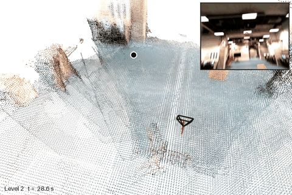

  <h1>Look-ahead Distance Validation for Neon-IMU-Analysis</h1>
  

    Vignesh Radhakrishnan, Mark Hollands 
    School of Sport &amp; Exercise Sciences, Liverpool John Moores University, UK
  

  

  

Validation of the look-ahead distance computed from Pupil Labs Neon gaze and our VidMap + VI trajectories, against motion capture (four trials, LJMU motion capture laboratory). Other eye metrics (fixations, saccades, pupil size) are taken as provided by Pupil Labs.

The results page is on the [website](https://vigneshrk29.github.io/gazeVerification/): pipeline, dataset, reference, metrics, ScaRF-SLAM maps with the gaze, tables and summary. The trajectories are validated on the [trajectory validation](https://vigneshrk29.github.io/trajectory-validation/) page.
